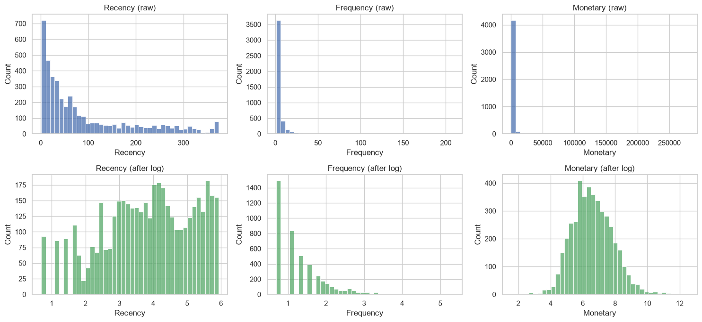
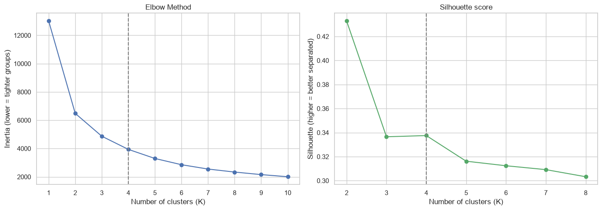
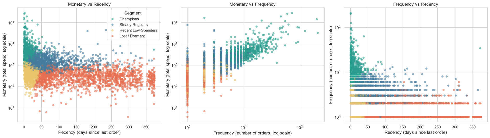
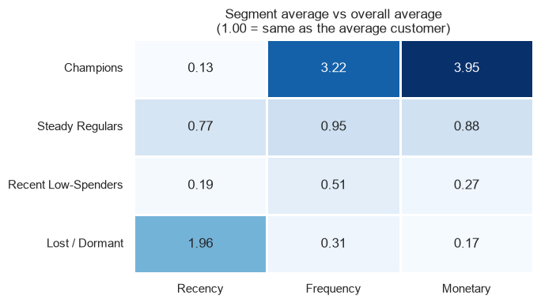
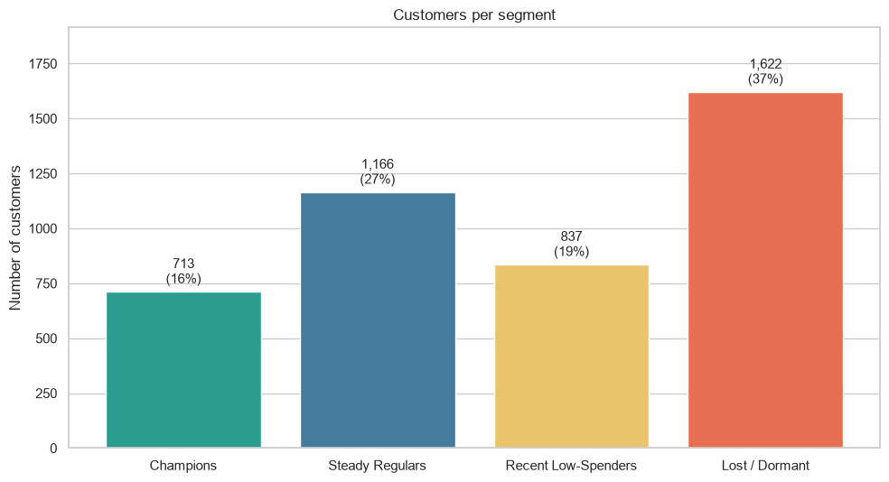

# Customer Segmentation Analysis

This project uses the Online Retail transaction dataset to group customers by purchasing behavior and suggest targeted marketing actions. The analysis is in [Customer_Segmentation_Analysis.ipynb](./Customer_Segmentation_Analysis.ipynb).

## Dataset

Place `Online_Retail.xlsx` in this folder. It contains 541,909 transaction line items with invoice, product, quantity, unit price, date, customer, and country fields. The notebook removes rows without a customer ID, exact duplicates, cancelled invoices, and rows with non-positive quantity or unit price. The cleaned analysis contains 4,338 customers.

## Method

1. Aggregate each customer's behavior as RFM: **Recency** (days since the last purchase), **Frequency** (number of invoices), and **Monetary** (total spend).
2. Apply a `log1p` transform to reduce skew, then standardize the features.
3. Use the elbow method and silhouette scores to compare cluster counts; select **K = 4** for interpretable, actionable customer groups.
4. Profile the resulting clusters and recommend marketing actions for each group.

## Results

| Segment | Customers | Avg. recency (days) | Avg. orders | Avg. spend | Share of revenue |
|---|---:|---:|---:|---:|---:|
| Champions | 713 (16.4%) | 12.2 | 13.8 | 8,088.0 | 64.9% |
| Steady Regulars | 1,166 (26.9%) | 71.6 | 4.1 | 1,801.8 | 23.6% |
| Recent Low-Spenders | 837 (19.3%) | 17.7 | 2.2 | 557.3 | 5.2% |
| Lost / Dormant | 1,622 (37.4%) | 181.5 | 1.3 | 341.0 | 6.2% |

Champions are only 16.4% of customers but account for 64.9% of revenue. Steady Regulars are a re-engagement opportunity, Recent Low-Spenders may benefit from onboarding and repeat-purchase offers, and a low-cost win-back campaign can be tested for Lost / Dormant customers. These findings describe this dataset and are not guarantees of future behavior.

## Analysis screenshots

The figures below are exported from the notebook's saved outputs.

### RFM distributions before and after the log transform



### Choosing the number of clusters



### Customer segments across RFM features



### Segment profiles compared with the overall average



### Number of customers in each segment



## Run the analysis

Use Python with Jupyter Notebook or JupyterLab. From this folder, install the notebook dependencies and launch Jupyter:

```bash
python -m pip install pandas numpy scikit-learn matplotlib seaborn openpyxl jupyter
jupyter notebook
```

Open `Customer_Segmentation_Analysis.ipynb` and run the cells in order.
