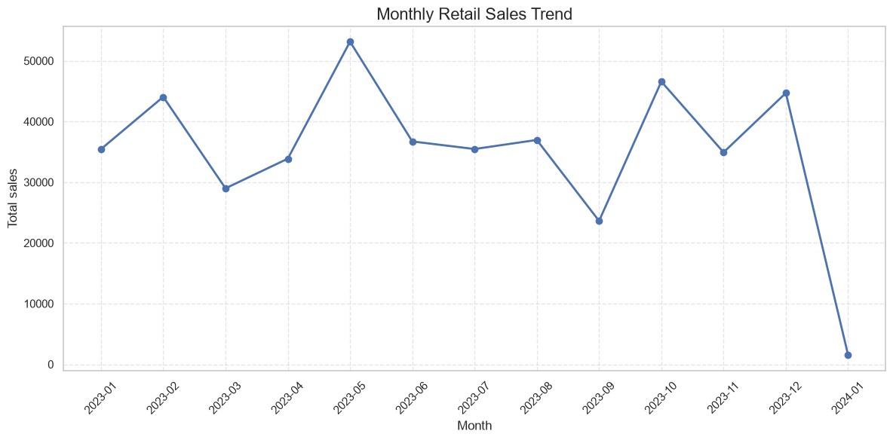
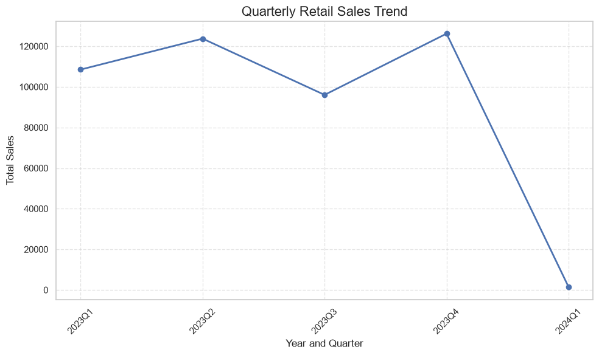
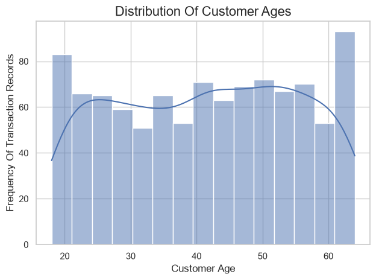
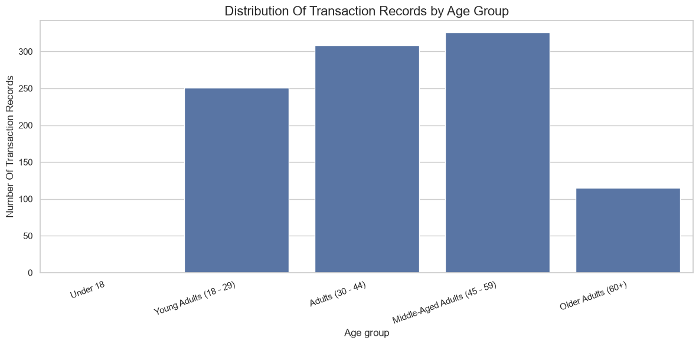
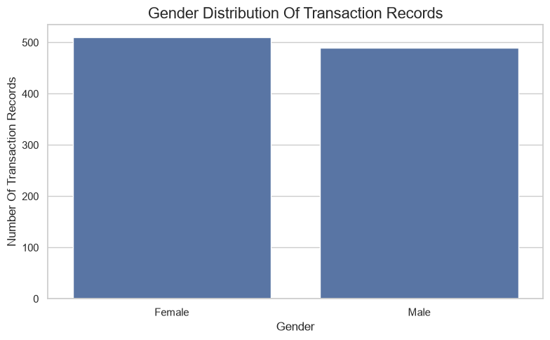
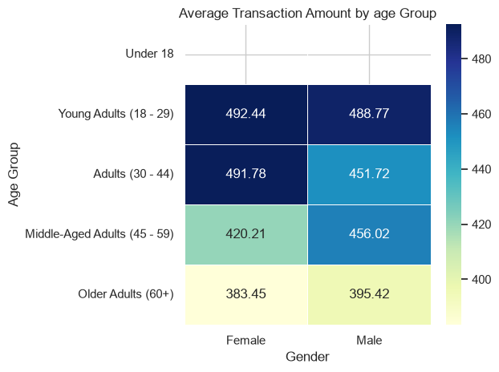
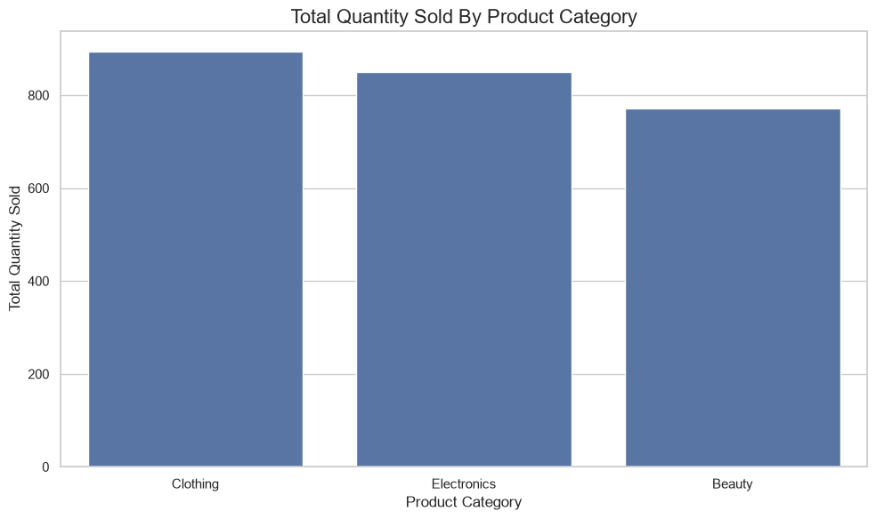
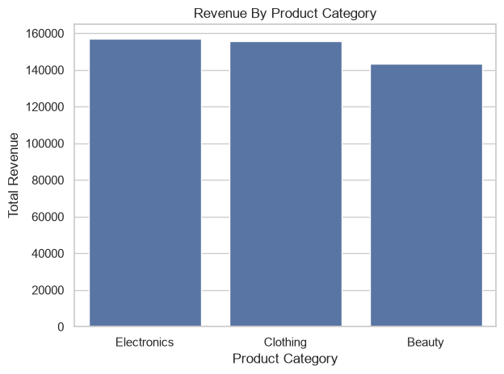
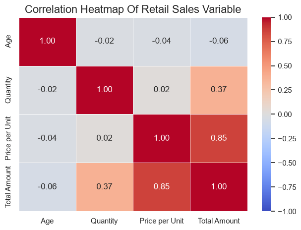
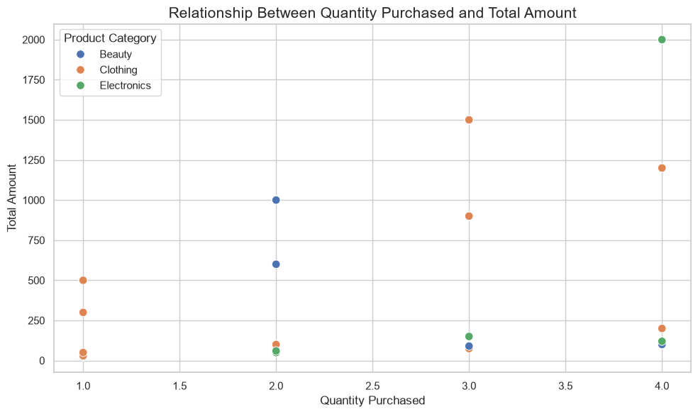

# Retail Sales Exploratory Data Analysis

This project explores a retail sales dataset using Python and Jupyter Notebook. The analysis looks at transaction and customer characteristics, compares sales across product categories, and examines relationships between customer age, quantity, unit price, and total amount.

## Project files

- `retail_sales.ipynb` — notebook containing the exploratory analysis and visualizations.
- `retail_sales_dataset.csv` — transaction dataset used by the notebook.

## Dataset

The dataset contains 1,000 transactions and the following columns:

| Column | Description |
|---|---|
| `Transaction ID` | Unique transaction identifier |
| `Date` | Transaction date |
| `Customer ID` | Customer identifier |
| `Gender` | Customer gender |
| `Age` | Customer age |
| `Product Category` | Product category (Beauty, Clothing, or Electronics) |
| `Quantity` | Number of units purchased |
| `Price per Unit` | Price of one unit |
| `Total Amount` | Total transaction amount |

## Requirements

Use Python with Jupyter Notebook or JupyterLab. The notebook uses:

- pandas
- NumPy
- Matplotlib
- Seaborn
- SciPy

Install the packages with:

```bash
python -m pip install pandas numpy matplotlib seaborn scipy jupyter
```

## Run the analysis

1. Open a terminal in this project folder.
2. Start Jupyter:

   ```bash
   jupyter notebook
   ```

3. Open `retail_sales.ipynb` and run the cells in order.

The notebook currently uses an absolute path to read the CSV. For portability, change that cell to load the file relative to the project folder:

```python
sales = pd.read_csv("retail_sales_dataset.csv", parse_dates=["Date"])
```

## Summary of findings

- **Quantity and total amount:** Transactions with larger quantities tend to have higher totals. The Pearson correlation is **0.374**, indicating a moderate positive association. The relationship is not exact because transactions have different unit prices.
- **Age and quantity:** There is essentially no linear association (**Pearson r = -0.024**).
- **Age and total amount:** The association is very weak and negative (**Pearson r = -0.061**); it was not statistically significant at the 5% level (p ≈ 0.056).
- **Quantity and price per unit:** There is essentially no linear association (**Pearson r = 0.018**).
- **Product categories:** Average transaction amounts are similar: Beauty **$467**, Electronics **$459**, and Clothing **$443**.
- **High transaction amounts:** The maximum total is **$2,000**. There are no Tukey outliers by the 1.5×IQR rule (upper fence **$2,160**).
- **Same quantity, different totals:** Yes. For each quantity from 1 to 4, the dataset contains five different total amounts, reflecting different unit prices.

Correlation values describe association and do not imply causation. The category and outlier results describe this dataset and should not be treated as universal patterns.

### Correlation results

The following Pearson correlations are calculated across all 1,000 transactions:

| Variables | Pearson correlation (r) | Interpretation |
|---|---:|---|
| Age and Quantity | -0.024 | Negligible linear association |
| Age and Total Amount | -0.061 | Very weak negative association |
| Quantity and Total Amount | 0.374 | Moderate positive association |
| Quantity and Price per Unit | 0.018 | Negligible linear association |

### Analysis snapshots

The figures below are snapshots of the visual outputs saved in `retail_sales.ipynb`.

#### Sales trends



Monthly transaction totals. May 2023 is the highest full month (**$53,150**) and September 2023 is the lowest (**$23,620**). January 2024 contains data for January 1 only, so it is not comparable to the complete months.



Quarterly transaction totals show the variation in sales across the reporting period.

#### Customer demographics



Customer age distribution across transaction records.



Transaction counts grouped by customer age.



The dataset includes 510 female and 490 male transaction records.



Average transaction amount by age group and gender. The empty “Under 18” row reflects that the dataset contains no customers under age 18.

#### Product performance



Total units sold by category: Clothing **894**, Electronics **849**, and Beauty **771**.



Total transaction amount by category: Electronics **$156,905**, Clothing **$155,580**, and Beauty **$143,515**.

#### Relationships between transaction variables



Pearson correlation heatmap for age, quantity, unit price, and total amount.



Transactions with the same quantity can have different totals because their unit prices and product categories differ.
